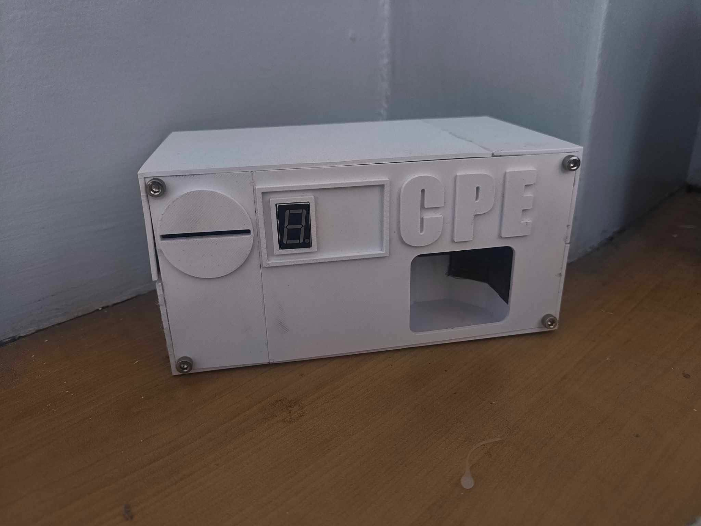
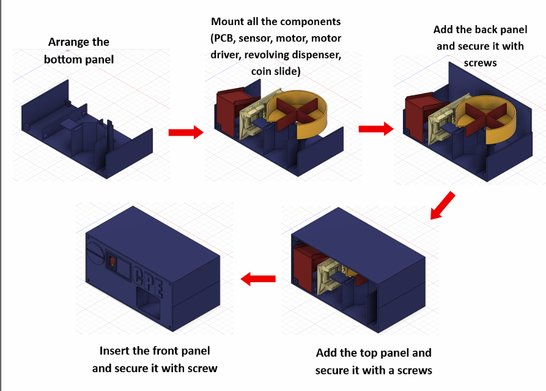
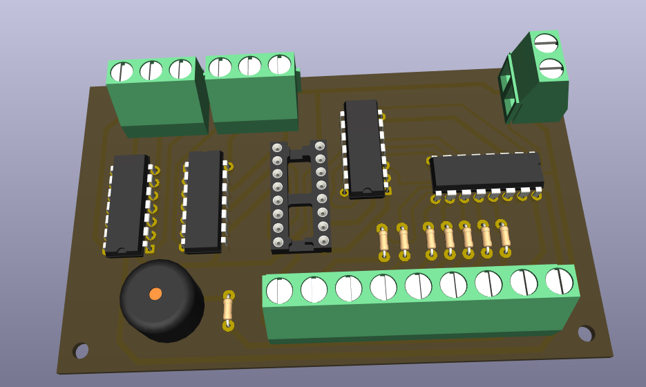
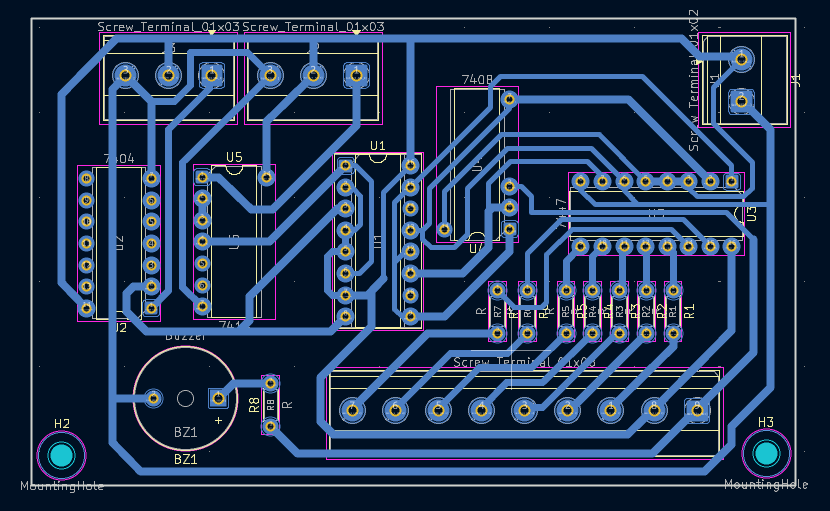

# Vending Machine

A coin-counting vending machine that uses flip-flop logic to count coins. It runs on a custom-built PCB and does not use a microcontroller.

## Hardware

- **Flip-Flops:** Basic sequential circuit components that provide memory. Used to count coins in the vending machine.
- **IR Sensor:** Detects a falling coin. It points at a black background and detects the change in color when a coin passes in front of it, which activates the counting circuit. A second IR sensor at the end of the machine detects when the object has been dispensed, which resets the counter.
- **L293D:** Motor driver that runs the motor for the wheel mechanism used to dispense objects.
- **5V DC Motor:** Spins the wheel mechanism to dispense the object.

## About The Machine

The vending machine was designed as a college project to demonstrate the use of flip-flops in practical circuits. We used a JK flip-flop based asynchronous counter. The IR sensor input drives the count up directly rather than a separate clock signal. The JK flip-flops also let us reset the counter using the IR sensor at the end of the machine once the object is dispensed.

The machine runs on a custom-built PCB that houses the logic components, including the gates, flip-flops, and the other parts that operate the rest of the machine. The PCB's output goes to a 7-segment display that shows the current coin count, and to the motor driver that drives the dispensing motor.

## Design

3D-printed body, designed in Autodesk Fusion:

## PCB

Designed in KiCAD and fabricated by toner transfer.

## Files

- 3D model (STL): [Vendo.stl](VendoDesign/Vendo.stl)
- PCB bottom copper layer (PDF): [VENDO-B_Cu.pdf](VendoPCB/VENDO-B_Cu.pdf)
- KiCAD project: [VENDO.kicad_pro](VendoPCB/VENDO.kicad_pro)
